<a href="https://ravnoor-portfolio.vercel.app/">
  
</a>

  
  
  
  




<!-- Project 1: Nyaya Sahayak -->
<a href="https://github.com/ravnoor-1407/Nyaya-Sahayak-Legal-AI-Assistant"></a>

  
  

<!-- Project 2: Amazon Clone -->
<a href="https://github.com/ravnoor-1407/Amazon-Clone"></a>

  

<!-- Project 3: CodeCaffeine -->
<a href="https://github.com/ravnoor-1407/CodeCaffeine"></a>

  

<!-- Project 4: WebDev Progress Log -->
<a href="https://github.com/ravnoor-1407/WebDev-Progress-Log"></a>

  



<a href="https://ravnoor-portfolio.vercel.app/"></a>


  
  
  
  

<a href="https://ravnoor-portfolio.vercel.app/">
  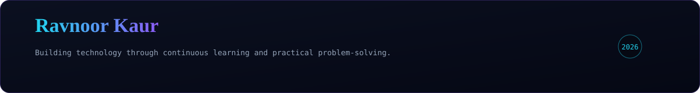
</a>
